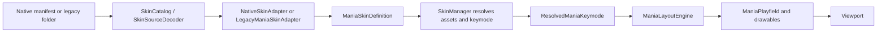

# Mania skin system

This subsystem keeps Native Nullscent skin semantics separate from osu! legacy compatibility. Legacy support targets osu!stable first; the optional Lazer profile is an explicitly experimental interpretation. The status labels below describe implemented consumers, not full osu! parity.

Nullscent has its own normalized presentation model. Native Nullscent skins and osu!mania legacy skins enter through different decoders, then use the same resolved assets, layout engine, and drawables.



## Responsibilities

| Component | Responsibility |
| --- | --- |
| `SkinConfigParser` | Reads `skin.ini` into a legacy-only input structure. It does not decide final geometry. |
| `SkinCatalog` | Validates a folder, builds the normalized definition, reports missing, ignored, and unsupported properties. |
| `SkinSourceDecoder` | Selects the native manifest or osu! legacy adapter. |
| `NativeSkinAdapter` | Validates and loads `NullscentSkin.json`. |
| `LegacyManiaSkinAdapter` | Converts keymode sections, assets, colors, dimensions, versions, body modes, and flips into engine units. |
| `ManiaSkinDefinition` / `ManiaKeymodeDefinition` | Normalized skin recipe independent from GPU textures and viewport dimensions. |
| `SkinAssetResolver` | Resolves filenames, animation frames, `@2x`, image decoding, CPU texture reduction, and one provider's texture cache. |
| `SkinManager` | Prepares and atomically activates a skin, resolves a keymode snapshot, applies internal fallbacks, and invalidates/disposes old assets. |
| `ResolvedManiaKeymode` | Cached per-keymode profile containing loaded note, receptor, LN, stage, lighting, and judgement animations. |
| `ManiaLayoutEngine` | Maps logical lane and receptor metrics to a resized physical viewport. It does not inspect texture dimensions. |
| `ManiaPlayfield` / drawables | Draw the supplied layout, resolved textures, and user scale values. They do not parse `skin.ini`. |
| `SettingsService` / `GameSettings` | Hold user preferences independently from skin data. |

The resolved profiles are treated as immutable after activation. Skin changes produce a new definition and resolver before the old resolver is disposed. `TryActivate()` can restore the prior provider and definition if persisting the selection fails.

## Coordinates and layout

`ManiaLayoutEngine` uses a 16:9 logical canvas that is 768 units high. It applies one uniform scale and centers that design canvas inside the physical viewport, so a different aspect ratio adds letterbox space instead of distorting lanes and sprites.

The legacy adapter translates osu!mania coordinates, whose horizontal positioning is documented relative to a 480-pixel-high stage, by `LegacyManiaSkinAdapter.StableScale` (`1.6f`). The conversion is:

```text
skin.ini legacy coordinate (480-high reference)
    -> normalized 768-high mania design coordinate
    -> uniform viewport scale and letterbox offset
    -> physical window coordinate
```

`ColumnStart`, `ColumnWidth`, spacing, hit/light/score/combo positions, note-height reference, and line widths are converted at the adapter boundary. Lane geometry comes only from normalized configuration; texture width never sets lane width. On aspect ratios other than 16:9, the logical field is centered with letterbox space; lane backgrounds, lines, scrolling bounds, and flashlight mask stay inside that field.

`LightPosition` is defined only for `StageLight`. The legacy decoder stores `(480 - value) * 1.6` as a bottom inset; Nullscent's equivalent top-origin logical anchor is `768 - inset`, or `value * 1.6`. Upscroll mirrors a configured anchor around the 768-unit design height. A native skin without a configured anchor defaults to the active scroll edge (bottom for downscroll, top for upscroll).

`ColumnRight` is **adapted**, not claimed to reproduce Stable exactly. The current layout engine treats it as an inward inset from the design canvas's right edge and constrains the playfield's right edge without changing lane widths. The wiki only describes it as the point up to which columns may be drawn, and I found no equivalent consumer in the current official osu!Lazer Mania skinning sources. This responsive interpretation is explicit and covered by the shared layout path.

Native `placement` accepts `center`, `left`, `right`, or `legacy`. Legacy skins use their configured start and right constraint; native skins can choose an anchor. `ManiaLayoutResult` separately carries lane rectangles, playfield bounds, viewport transform, note-height scale, receptor-height scale, and hit position.

`WidthForNoteHeightScale` becomes `NoteHeightReferenceWidth`. If absent, the adapter uses the narrowest lane. Legacy notes and all LN pieces use that reference so differing column widths do not change their height unexpectedly; receptors keep their own skin geometry. Native note, LN, and receptor styles each have independent width ratios and height policies. User `SkinNoteHeightScale` and `SkinReceptorHeightScale` affect sprite height without changing lane geometry.

The engine-level `PlayfieldScale` and `LaneScale` inputs exist for future user/native overrides; the current settings UI does not expose them.

## Native skin format

Each built-in skin is data under `Nullscent/Skins/<id>/`:

```text
NullscentSkin.json
bar-note.png
bar-key.png
bar-key-pressed.png
bar-hold-head.png
bar-hold-body.png
bar-hold-tail.png
```

`formatVersion` is currently `1`. The manifest contains `id`, `name`, `author`, and a `keymodes` object keyed by key count. Every keymode declares its `keyCount`, `placement`, optional hit position, column line settings, shared sprite styles, stage/lighting names, optional `stageStyle`, the optional `flipLightingHorizontallyWhenUpsideDown` flag, optional per-part `stageAssetAnimations`, optional `judgementTiming` / `noteLightingTiming` / `holdLightingTiming` policies, and a `lanes` array with one record per column. The lighting flip defaults to `false` for existing native manifests. Omitted timing policies preserve the existing FPS defaults. `stageStyle` independently controls `sideHeightScale`, `hintHeightScale`, and `bottomScale`; omitted values keep native defaults.

`placement` accepts `center`, `left`, `right`, or `legacy`. Before activation, `NativeSkinAdapter` validates lane count and dimensions, positive sprite ratios, finite offsets and coordinates, hit-position ratio range, animation rates, stage scales, hold anchors, enums, and nonnegative finite line/lighting widths. An invalid manifest is rejected so it cannot replace the active skin. Position offsets remain signed so a skin can intentionally place a sprite beyond its nominal bounds.

Sprite styles can set `asset`, `pressedAsset`, `animate`, `laneWidthRatio`, `heightMode`, `heightValue`, offsets, `framesPerSecond`, and an optional `timing` policy. `animate` defaults to `true`; when false, numbered frames are not discovered and the static asset is resolved. `stageAssetAnimations` maps stage-part names to the same static/animated policy. `heightMode` is `TextureAspect`, `ReferenceWidthAspect`, or `LaneWidthFraction`; on tiled LN bodies it sets the repeat tile height, while `OffsetY` shifts the body span as a whole. A timing policy sets `minimumFrameDurationMs`; optional `targetAnimationDurationMs` spreads the frames over that duration without exceeding the minimum frame duration. `framesPerSecond` remains the fallback when `timing` is omitted. Lane definitions independently support width, following gap, note/receptor/body width ratios, per-piece asset overrides, body mode, and lane/light/hold colors. `holdAssembly.headConnectionRatio` and `tailConnectionRatio` specify how far the body overlaps each cap, from 0 (join at the cap edge) to 0.5 (reach its centre). Bars uses edge joins; Circles overlaps its narrow connector under each circular cap. JSON enums are case-insensitive.

To add a keymode, add its profile and exactly one lane definition per column. To add an animation, name the first image `name-0.png`, then consecutive frames `name-1.png`, etc.; if no numbered frame exists, the resolver treats `name.png` as a static one-frame asset. `_blank` means intentional transparency.

## Built-in families

### Bars

`Nullscent/Skins/Bars` is the initial internal skin and the final safe visual provider. It uses full-lane rectangular notes, a stretched LN body, rectangular receptors, per-key colors, and 4K/7K profiles. Its art and proportions are manifest/assets, not a renderer branch.

### Circles

`Nullscent/Skins/Circles` uses narrower centered note sprites and independent circular receptors inside wider lanes. Its LN body tiles and its 7K manifest includes a wider center separation. It uses the same model, resolver, layout engine, and drawables as Bars.

Both manifests ship with the application and are selectable through the same catalog as external skins.

## Legacy adapter

The adapter uses the `skin.ini` version contract:

* A skin with no `skin.ini` uses latest legacy conventions and conventional asset names.
* A present `skin.ini` with no `Version` uses legacy version 1.0.
* A skin in the reserved `User` folder uses latest rules even if its `skin.ini` says otherwise.
* Version 2.4 enables the documented two-sided column edge behavior and uses the post-2.4 HUD scale.
* Version 2.5 enables `NoteBodyStyle`, per-column lighting widths, and Stable's detailed note/key flip overrides. Stable does not direction-flip mania note sprites before v2.5. The experimental LazerLegacy profile follows current lazer's directional sprite flipping and does not apply the parsed legacy note/key flip settings.

Each repeated `[Mania]` section is keyed by `Keys`. Extra list entries are ignored and missing or malformed entries use that field's format default without shifting later columns. A present `skin.ini` creates profiles only for keycounts with an explicit valid `[Mania] Keys`; a missing keycount uses the complete internal keymode profile and its matching assets. This avoids combining guessed external geometry with a different internal mode. A file without `skin.ini` uses conventional names for any requested keycount; the catalog lists 4K/7K when it finds recognized conventional artwork.

For conventional lane assets, the documented 1K–9K pattern alternates `mania-note1` and `mania-note2` inward from each edge, with `mania-noteS` at the centre for odd keycounts. Stable's `SpecialStyle` can move the special lane to the configured left or right side for single play. The experimental Lazer profile ignores that setting and keeps the conventional pattern. The special lane location beyond the documented default table is not established here.

### Compatibility profile

`SkinProviderKind` records the source (osu! legacy, Nullscent native, or emergency); `ManiaSkinCompatibilityProfile` records the interpretation used to normalize that source. The persistent `LegacySkinCompatibilityMode` defaults to `Stable` and is consulted only for osu! legacy folders. Changing it rebuilds the selected legacy skin transactionally. Native manifests keep `NullscentNative` semantics and appearance under either setting.

The legacy LN body animation clock is normalized into the keymode model. It stays at its initial frame before the head is hit, advances from the hit time while held, and follows a per-profile release policy. Stable uses `FreezeAtRelease` after either a successful tail release or an early break, interpreting the wiki's “stops if released” contract as holding the current frame; the wiki does not specify cursor reset details, so this is the conservative policy rather than a claim of exact Stable internals. Lazer uses `ResetToInitialFrame`, matching the current official [`LegacyBodyPiece.Update()`](https://github.com/ppy/osu/blob/master/osu.Game.Rulesets.Mania/Skinning/Legacy/LegacyBodyPiece.cs) behavior. This Lazer subset remains experimental.

While a legacy hold is successfully active, its tail asset is clipped to the approach side of the hit position; the body keeps its existing span clamp. The tail uses a matching source crop so only pixels inside that region are submitted. This adapts lazer's masked hold composition and the [osu! issue documenting that tails should be masked at the judgement line, as in Stable](https://github.com/ppy/osu/issues/12128). The new tail crop is legacy-only and does not change Native cap presentation. This is a targeted compatibility rule, not a claim of complete Stable hold-note parity.

Mania judgement sprites (`mania-hit0`, `mania-hit50`, `mania-hit100`, `mania-hit200`, `mania-hit300`, `mania-hit300g`) use the documented fixed 60 FPS loop in StableLegacy. LazerLegacy follows `ManiaLegacySkinTransformer`, which requests a fixed 20 FPS for these sprites. Neither profile derives judgement timing from the general `AnimationFramerate` value.

### Legacy property status

`SUPPORTED` means the property reaches an active renderer/layout consumer. `ADAPTED` means it is applied using a documented Nullscent policy where exact Stable semantics are not established. `IGNORED BY DESIGN` means it is parsed for useful diagnostics but the corresponding feature is not part of this renderer. `UNSUPPORTED` means no usable normalized behavior exists.

Legacy property diagnostics use the selected compatibility profile and the skin's effective version. Flip commands and other v2.5 properties are reported as version-inapplicable on older skins; v2.5 flip commands are reported as intentionally unused under the current experimental LazerLegacy profile. Command and section spelling is case-sensitive. Empty `Key:` placeholders from the official blank template are informational no-ops and leave format defaults active. Malformed values, unknown properties, unsupported features, transparent blanks, missing assets, fallback use, and malformed `@2x` pairs have structured diagnostics; they are collected during parse/catalog/resolve/activation rather than in draw loops.

| Properties | Status | Current behavior |
| --- | --- | --- |
| `Keys`, `ColumnWidth`, `ColumnSpacing`, `ColumnLine`, `ColumnLineWidth` | SUPPORTED | Per-keymode lanes and line geometry; missing values use defaults. Legacy negative `ColumnLineWidth` values suppress their corresponding borders, and positive widths use osu!'s 0.740 transform. |
| `ColumnStart` | ADAPTED | Converts the documented 480-high coordinate to logical units and anchors the left edge. |
| `ColumnRight` | ADAPTED | Right-edge constraint in the responsive design canvas; exact Stable parity is uncertain. |
| `HitPosition`, `LightPosition`, `ScorePosition`, `ComboPosition` | SUPPORTED | Converted once; hit position feeds layout, score/combo feed legacy judgement presentation. |
| `WidthForNoteHeightScale` | SUPPORTED | Sets note/head/body/tail height reference; absent uses the narrowest lane. |
| `JudgementLine`, `KeysUnderNotes`, `ColumnLighting` | SUPPORTED | Reach judgement line visibility, receptor/note ordering, and column light state. |
| `mania-hit#` judgement animations | ADAPTED | StableLegacy uses the wiki's fixed 60 FPS loop. LazerLegacy follows `ManiaLegacySkinTransformer` at fixed 20 FPS. |
| `NoteImage#`, `NoteImage#H/#L/#T`, `KeyImage#`, `KeyImage#D` | SUPPORTED | Resolve per-column assets; absent LN tail may reuse the head. Missing active-skin assets fall back to built-in assets. |
| `NoteBodyStyle`, `NoteBodyStyle#` | ADAPTED | Stable `0` stretches, `1` tiles from tail to head, `2` from head to tail; recognized nonstandard textual aliases are diagnosed and normalized. Applied for version 2.5+. The experimental Lazer profile collapses non-stretch styles to the tail-side repeat. |
| `NoteFlipWhenUpsideDown[#][H/L/T]`, `KeyFlipWhenUpsideDown[#][D]` | SUPPORTED in StableLegacy v2.5+; ignored by LazerLegacy | Stable applies global, column, note-piece, and pressed-key overrides from v2.5. Stable note auto-flip is disabled before v2.5. Current LazerLegacy auto-flips sprites by scroll direction and does not consume these configuration keys; that profile remains experimental. |
| `UpsideDown` | ADAPTED | A skin orientation preference; it controls scroll only while the user has enabled “Use Skin Scroll Direction”. Explicit user choice wins. |
| `Colour#`, `ColourHold`, `ColourColumnLine` | SUPPORTED | RGB and optional alpha are preserved; `ColourHold` tints the combo counter while holding, and lane colors feed their corresponding visuals. |
| `ColourBreak`, `ColourJudgementLine`, `ColourLight#` | SUPPORTED | These properties accept RGB. Any extra alpha component is ignored with a diagnostic. `ColourLight#` tints that lane's `StageLight` only; `LightingN` and `LightingL` remain untinted for legacy skins. Native manifests retain their `lightColor` tint and may specify `stageLightColor` independently. |
| `ColourHold#` | UNSUPPORTED | The legacy contract documents only the global `ColourHold`; numbered variants are reported instead of being treated as per-column osu! behavior. Native manifests can still define per-lane hold-counter tint. |
| `StageLeft`, `StageRight`, `StageBottom`, `StageHint`, `StageLight`, `LightFramePerSecond` | SUPPORTED | Stage geometry is normalized separately from lanes and assets; `LightFramePerSecond` controls `StageLight`. Legacy side pieces fit the stage height, `StageBottom` uses the legacy 1.6 scale and scroll-edge anchor, and `StageHint` spans the stage and centers on the judgement line. `StageLight` keeps a fixed draw rectangle while its release fade changes alpha. |
| `LightingN`, `LightingL`, `LightingNWidth`, `LightingLWidth` | ADAPTED | Both assets use additive blending and lane-centred sizing. StableLegacy flips them horizontally on upscroll per the [osu!mania skinning contract](https://osu.ppy.sh/wiki/en/Skinning/osu!mania#lighting). The current [Lazer hit explosion](https://github.com/ppy/osu/blob/master/osu.Game.Rulesets.Mania/Skinning/Legacy/LegacyHitExplosion.cs) and [hold body](https://github.com/ppy/osu/blob/master/osu.Game.Rulesets.Mania/Skinning/Legacy/LegacyBodyPiece.cs) use `max(1000/60 ms, 170 ms / frameCount)` for their animated lighting and change vertical anchors without the Stable horizontal flip. LazerLegacy preserves that source behavior and remains experimental. Native manifests can opt in with `flipLightingHorizontallyWhenUpsideDown` (default `false`). |
| `BarlineHeight`, `ColourBarline` | IGNORED BY DESIGN | Parser retains them for reporting; no barline renderer exists yet. |
| `SpecialStyle` | ADAPTED in Stable; ignored in LazerLegacy | The conventional 1K–9K pattern keeps `S` at the centre of odd keycounts by default. Stable maps it to the configured left or right single-play lane when set. Double-play split-stage positioning is unsupported and diagnosed for even keycounts above 4. Current Lazer stores this option for encode/decode stability but does not consume it, so LazerLegacy leaves the conventional pattern intact. |
| `[Colours] Combo1`–`Combo8` | IGNORED BY DESIGN | Parsed and retained, but the current Mania HUD does not implement beatmap skin-colour precedence or combo-colour selection. |
| `[General] Name`, `Author`, `Version`, `AnimationFramerate`; `[Fonts] ComboPrefix`, `ComboOverlap` | SUPPORTED | Metadata, animation default, and legacy digit presentation are carried into their consumers. Unknown entries in these sections are diagnosed. |
| `SplitStages`, `StageSeparation`, `SeparateScore`, `WarningArrow`, `ColourKeyWarning`, `ColourHold#` | UNSUPPORTED | Not converted to a renderer feature. The catalog reports unsupported legacy entries it detects. |

`NoteBodyStyle` string aliases currently accepted are `stretch`; `repeatbottom`, `repeat-bottom`, `bottom`, `tilefromtail`, `tile-from-tail`; and `repeattop`, `repeat-top`, `top`, `tilefromhead`, `tile-from-head`.

The normalized tile modes name the semantic anchor: the note head is the hold start, and the tail is its end. Downscroll places the tail at the upper edge and head at the lower edge; upscroll mirrors those positions. `TileFromTail` therefore starts at the upper edge in downscroll and the lower edge in upscroll. `TileFromHead` uses the opposite edge. Partial end tiles crop the matching source rows instead of stretching them. Stretch maps the whole source image over the body. A missing legacy tail may use the selected skin's head first; otherwise each missing piece uses its matching internal component. The direction mapping is covered by geometry tests for both scroll directions. The mapping follows the published Stable behavior, not the known current Lazer regression where style 1 and 2 do not retain distinct directions.

Legacy hold body geometry overlaps halfway beneath the head and tail caps, following osu!'s `DrawableHoldNote` placement (`-Head.Height / 2` and the matching half-height tail extension). This rule is normalized only for osu! legacy profiles; Native skins continue to use their manifest assembly ratios. The exact historical Stable overlap amount is not specified by the wiki and has not been compared against a live Stable build, so this remains an evidence-based adaptation rather than a claim of exact Stable parity.

The Lazer profile is deliberately not described as an exact port of its body sizing. The current official `LegacyBodyPiece` uses repeat wrapping for every non-stretch style, anchors by scroll direction, and scales the body sprite using `32800 / sprite.DrawHeight`. Nullscent currently repeats according to the resolved asset's logical aspect and width, while normalizing both Lazer repeat styles to the tail-side anchor. Very tall assets with transparent source regions can therefore show a different portion or an apparently empty body under this experimental profile. This does not affect Stable or Native. See the official [LegacyBodyPiece source](https://github.com/ppy/osu/blob/master/osu.Game.Rulesets.Mania/Skinning/Legacy/LegacyBodyPiece.cs) and [NoteBodyStyle issue #35502](https://github.com/ppy/osu/issues/35502).

## Assets, `@2x`, and fallbacks

`SkinAssetResolver` checks only the selected provider's directory, including its optional `@2x` variant. The active user skin never borrows arbitrary files from another external skin. Resolution order is:

```text
selected skin provider
    -> built-in Bars provider
    -> emergency geometric/text fallback if a required visual is still absent
```

For a keymode missing from a selected definition, the whole internal keymode profile and its matching built-in assets are used rather than mixing geometry from unrelated keymodes. For a present partial keymode, missing individual images use the matching internal component. Native definitions never receive osu! conventional filenames; those names are introduced only by `LegacyManiaSkinAdapter`.

`@2x` changes physical source pixels, not logical display size. When a 1x companion exists, an `@2x` variant is accepted only if both axes are exactly twice the 1x dimensions; a mismatched variant is diagnosed and ignored so its source art cannot distort the 1x geometry. A valid pair uses the 1x dimensions as `LogicalSize`. An `@2x`-only asset uses half its source dimensions. `SourcePixelSize` and `TexturePixelSize` retain the physical source and GPU upload dimensions. When the GPU limit is exceeded, the decoder downsamples on CPU with one uniform ratio before upload. The game requests MonoGame `HiDef` when the active adapter reports support and falls back to `Reach` otherwise; the loader attempts 8192 per axis for `HiDef` and 2048 for `Reach`, retrying smaller uploads if the device rejects a size. GPU downsampling does not change logical dimensions.

The `SkinAssetResolver` is owned by a single provider and caches decoded textures. Activation stages the candidate provider, resolves all supported keymode snapshots (1K through 18K), and prepares score/combo glyphs and scorebar assets before persisting and publishing the new version. HUD number drawing reads those prepared glyph sets without filesystem access or temporary texture/width lists. Only after publication are replaced resolvers disposed. If resolution or persistence fails, the previous definition, active/internal providers, setting, and resolved caches are restored together. The internal fallback provider is reused across ordinary skin activation and rebuilt alongside the selected provider when the @2x preference changes.

## Animation rules

The resolver discovers numbered frames during keymode preparation and stores them in `ResolvedSkinAnimation`; Mania draw calls read the prepared snapshot and do not discover keymode assets or enumerate animation frames. Frames, stage assets, and judgement maps are exposed as read-only snapshots; animation lookup APIs return `IReadOnlyList<Texture2D>` so callers cannot reorder or remove cached frames. The DEBUG smoke harness asserts that all supported keymode snapshots exist before the first draw and checks rollback after injected persistence failures. `FrameAt()` loops through the cached frames. Generic non-Mania assets retain the resolver's lazy, per-name cache.

* `AnimationFramerate` is normalized from `[General]`. A positive value is preserved; `-1` resolves to the frame count, meaning the complete animation spans one second.
* Mania notes, LN heads/bodies/tails, and note/hold lighting do not inherit the general rate. The wiki establishes that these are AnimationFramerate exceptions but does not specify every Stable frame cadence; Nullscent uses 60 FPS for note/head/tail and lighting and 30 FPS for the body as explicit approximations. The Stable body stop behavior is also an interpretation of “stops if released,” not proof of cursor-reset behavior. Resolved animations retain exact frame duration, including non-integer effective FPS.
* `LightFramePerSecond` controls the `StageLight` animation only.
* `LightingN` starts from each judged note's elapsed time. `LightingL` starts from the successful LN head and continues through the existing 120 ms release fade; a regular tap does not trigger hold lighting. The hold-start reset follows the osu!mania animation contract and the local Lazer `LegacyBodyPiece` reset; Nullscent's release-fade duration is its own visual policy, not a claim of exact Stable timing.
* The official osu!mania asset table marks key images, `StageLeft`, `StageRight`, and `StageHint` static; the resolver therefore loads one frame for them. `StageBottom` and `StageLight` support numbered frames. `StageBottom` follows the general rate and `StageLight` uses `LightFramePerSecond`. Stable legacy `mania-hit#` assets use the wiki fixed 60 FPS loop; the Lazer legacy transformer uses fixed 20 FPS for those judgement sprites. Lazer `lightingN`/`lightingL` use source-derived `max(1000/60 ms, 170 ms / frameCount)` timing, while its LN body uses an explicit 30 ms frame duration. Native keymodes can override animation policy and timing through the manifest.

Sources: [osu!mania hit-burst contract](https://osu.ppy.sh/wiki/en/Skinning/osu!mania#hit-bursts), [Lazer ManiaLegacySkinTransformer](https://github.com/ppy/osu/blob/master/osu.Game.Rulesets.Mania/Skinning/Legacy/ManiaLegacySkinTransformer.cs), [Lazer LegacyHitExplosion](https://github.com/ppy/osu/blob/master/osu.Game.Rulesets.Mania/Skinning/Legacy/LegacyHitExplosion.cs), and [Lazer LegacyBodyPiece](https://github.com/ppy/osu/blob/master/osu.Game.Rulesets.Mania/Skinning/Legacy/LegacyBodyPiece.cs). Nullscent applies those frame pacing rules to its cached MonoGame animation snapshot without copying osu! framework classes.

## Layering and HUD

The current playfield order is:

1. Stage background and side pieces, then lane backgrounds/lines and the centered hit target.
2. Stage/column light behind notes.
3. Notes and receptors in the order selected by `KeysUnderNotes`.
4. `StageBottom` over the lane pass.
5. Flashlight mask.
6. Legacy judgement/combo display.
7. Foreground hit explosions and active LN lighting.

`StageLeft` and `StageRight` keep their logical texture width and fit the stage height. `StageHint` fits the full playfield width and uses a normalized vertical multiplier centered at `ReceptorY`. `StageBottom` keeps its logical pixel dimensions, applies the normalized scale, and anchors to the bottom for downscroll or top for upscroll; it is drawn over the notes. Native manifests can tune the three scales through `stageStyle`. Legacy normalization uses the 1.6 conversion for its 480-high art and the osu! legacy hit-target multiplier `0.9 * 1.6025`; the latter is taken from osu!'s current legacy implementation because the wiki describes the centered, full-width contract but does not publish that vertical factor. Nullscent score/accuracy/progress UI remains engine UI; legacy score/combo positions and skin digit assets feed the legacy presentation path where present.

## User preferences and precedence

* Receptor position: when `UseSkinReceptorPosition` is on, use the skin hit position; otherwise use the user's normalized `ReceptorPosition`.
* Scroll direction: when `UseSkinScrollDirection` is on and the skin defines `UpsideDown`, `0` means downscroll and `1` means upscroll. Otherwise retain the saved user `DownScroll`. Toggling `Down Scroll` sets an explicit user direction and disables following the skin.
* Note height and receptor height are independent settings. They are passed through the layout result to drawables; neither changes lane width.
* Skin files are not mutated to apply user preferences.

Hitsound source selection remains independent from visual asset resolution. `UseSkinHitsounds` controls whether the active skin directory participates; `OverrideMapHitsounds` chooses whether that directory precedes beatmap samples or follows them. If skin hitsounds are disabled, map samples remain first even when override is enabled. The application sound directory remains the final fallback, and skin changes or either setting change clear the sample cache.

## Validation states and diagnostics

`SkinCatalog` reports `Valid`, `Partial`, or `Invalid`. A partial skin remains usable when missing art can safely fall back. Invalid native manifests or parse errors do not replace the currently active skin. Missing images and ignored/unsupported properties are reported during validation/resolve, not every frame.

A folder with a valid Native manifest or a `skin.ini` remains selectable when it has no images; its missing components fall back to the internal provider and catalog status is `Partial`. An actually empty folder and malformed/invalid Native manifests are `Invalid`. A folder without `skin.ini` but with recognized conventional Mania assets uses latest rules; catalog status remains `Partial` because it has no explicit keymode configuration and may need defaults/fallbacks.

The current catalog marks properties by actual adapter/consumer status, not by parser recognition alone. `ColourHold#` is reported as unsupported: the legacy adapter applies only the documented global `ColourHold`; per-lane `holdColor` remains a Nullscent Native feature. `BarlineHeight` and `ColourBarline` are parsed but reported as ignored until a barline renderer exists.

## Regression evidence

The DEBUG deterministic suite covers Native Bars/Circles at 4K/7K, legacy parser and adapter behavior, the published 1K–9K conventional asset pattern, version gates, fallback resolution, long-note geometry, HD logical sizing, and responsive layout calculations. The available checkout contains no third-party regression skin assets, so these checks do not claim visual parity against an external skin.

## Validation commands

Run the project build with Windows targeting enabled when using a non-Windows build host:

```sh
dotnet build Nullscent/Nullscent.csproj -p:EnableWindowsTargeting=true
```

The headless deterministic checks are compiled in DEBUG and can run with:

```sh
dotnet run --project Nullscent/Nullscent.csproj -- --skin-tests
```

On Windows, graphical checks use `--skin-visual-smoke <skinPath> <keyCount> <outputPng> [up] [width] [height]`, `--skin-visual-resize-smoke`, `--skin-visual-switch-smoke`, `--skin-visual-profile-cycle-smoke`, and `--skin-visual-hd-cycle-smoke`. A smoke run should include Native Bars and Circles at 4K/7K, a legacy 4K/7K skin, a partial legacy skin, both scroll directions, 1366×768 and 1920×1080, resize, HD toggles, profile toggles, taps, chords, holds, release, and missing assets. These graphical commands require the Windows MonoGame/DirectX runtime; a successful headless test run is not a substitute for them.

No skin-name, folder-name, or asset-hash branch is part of the implementation.

The DEBUG-only harness is `SkinVisualSmokeGame`, invoked by `--skin-visual-smoke`, `--skin-visual-switch-smoke`, `--skin-visual-cycle-smoke`, `--skin-visual-profile-smoke`, `--skin-visual-profile-cycle-smoke`, `--skin-visual-resize-smoke`, `--skin-visual-timeline-smoke`, and `--skin-visual-hd-cycle-smoke`. The timeline command captures a deterministic approach, hold, animation-progress, early-release, tail-approach, explicit release, automatic tail completion, and its lighting fade for any skin and keycount. The skin-cycle command applies multiple destination skins in order (including the `internal` provider token), checking rollback on rejected persistence, cache/snapshot replacement, settings selection and hitsound directory after each activation. The profile-cycle command applies one or more Stable/Lazer changes in the same manager session: legacy providers must rebuild their profile and snapshots transactionally, while Native must retain the same definition, profile, keymode and HUD cache and only update the saved legacy preference. Both paths check persistence rollback, provider metadata, selection and hitsound path. The HD-cycle command toggles the @2x preference in one manager session, checks failed-save rollback, rebuilds the selected and internal fallback providers together, and verifies unchanged logical size for a paired 1x/@2x asset when available. Other commands accept arbitrary skin paths, keycounts, resolutions, up/downscroll, controlled chords and LN patterns. `Game1.SelectSkin()` and the runtime-switch smoke share `SkinSelectionWorkflow.TrySelect()`, including validation, transactional settings persistence, active-skin activation, and the post-activation hitsound directory/cache callback. The smoke supplies in-memory persistence, so it does not write the user's settings file. `Game1.SetLegacySkinCompatibilityMode()` and the profile smokes share `LegacySkinCompatibilityWorkflow`, including persisted-setting rollback, transactional `SkinManager` rebuild, and catalog refresh. `Game1.SetHighResolutionSkinAssets()` and the HD-cycle smoke share `HighResolutionSkinWorkflow`; failed settings persistence restores the previous preference and providers. The harness is excluded from Release by `#if DEBUG`.

The timeline captures checkpoints at 1275ms (halfway through the 250ms `StageLight` fade after the 1150ms key release) and 1410ms (after it completes). Notes continue scrolling between those screenshots, so they do not isolate the light by pixel comparison. The renderer keeps the light rectangle fixed from the lane and texture aspect ratio while the fade changes tint alpha. This fixed-geometry release is the Stable-first contract for Nullscent. Current Lazer's [`LegacyColumnBackground`](https://github.com/ppy/osu/blob/master/osu.Game.Rulesets.Mania/Skinning/Legacy/LegacyColumnBackground.cs) also animates the light's vertical scale toward zero on release; Nullscent deliberately does not reproduce that squash, so the LazerLegacy `StageLight` release transform remains unsupported and the profile is experimental.

Append `--stage-only` to `--skin-visual-profile-cycle-smoke` to run the same profile activation cycle without notes, key presses, or judgements. This isolates stage composition for Stable/Lazer comparison while still using the normal skin resolver and layout.

## Adding a Native skin

1. Create `Nullscent/Skins/<id>/NullscentSkin.json` with a new `id`, metadata, and one profile per desired keycount.
2. Define each lane width and gap independently. Choose note, receptor, LN, and stage assets through style fields or lane overrides.
3. Choose `TextureAspect`, `ReferenceWidthAspect`, or `LaneWidthFraction` for each sprite role; set independent width ratios and offsets.
4. Choose `Stretch`, `TileFromTail`, or `TileFromHead` for LN body rendering.
5. Add regular and optional `@2x` images. Use consecutive `name-0`, `name-1` animation frames when animated.
6. Validate the folder in the catalog, then run DEBUG smoke for 4K and 7K at 1920x1080 and 1366x768, including long notes and one resize.
7. Review both missing-asset warnings and the generated screenshots. The renderer should not need a skin-name branch.

## References and limits

* Official [osu! skin.ini wiki](https://osu.ppy.sh/wiki/en/Skinning/skin.ini): version defaults, 480-pixel Mania coordinate reference, missing/extra list rules, `NoteBodyStyle`, and animation exceptions.
* Official [osu!mania skinning wiki](https://osu.ppy.sh/wiki/en/Skinning/osu!mania): note origins, per-column width scaling, long-note pieces, stage layering, lighting blend mode, and animation contracts.
* Official osu! issue [#35502: `NoteBodyStyle` setting broken in mania](https://github.com/ppy/osu/issues/35502): documents Stable's three body styles and the current Lazer direction regression.
* Official [blank skin.ini template](https://osu.ppy.sh/wiki/en/Skinning/skin.ini/Blank): property sections and accepted legacy field names.
* Official current osu!Lazer source: [`LegacyBodyPiece`](https://github.com/ppy/osu/blob/master/osu.Game.Rulesets.Mania/Skinning/Legacy/LegacyBodyPiece.cs), [`LegacyColumnBackground`](https://github.com/ppy/osu/blob/master/osu.Game.Rulesets.Mania/Skinning/Legacy/LegacyColumnBackground.cs), [`LegacyHitExplosion`](https://github.com/ppy/osu/blob/master/osu.Game.Rulesets.Mania/Skinning/Legacy/LegacyHitExplosion.cs), [`LegacyNotePiece`](https://github.com/ppy/osu/blob/master/osu.Game.Rulesets.Mania/Skinning/Legacy/LegacyNotePiece.cs), [`ManiaLegacySkinTransformer`](https://github.com/ppy/osu/blob/master/osu.Game.Rulesets.Mania/Skinning/Legacy/ManiaLegacySkinTransformer.cs), and [`LegacyManiaSkinDecoder`](https://github.com/ppy/osu/blob/master/osu.Game/Skinning/LegacyManiaSkinDecoder.cs). These sources were used as Lazer evidence only; no source files were copied into Nullscent.
* osu!Lazer PR [#22389](https://github.com/ppy/osu/pull/22389): reference for decoding oversized images on CPU before GPU upload. Nullscent uses its own MonoGame resolver/downscale implementation.
* No osu!stable executable or source checkout was available for runtime comparison. Stable-specific claims are limited to the official wiki and issue evidence; uncertain behavior is called adapted or approximate.

Beatmap skin precedence, split stages, barlines, other rulesets, and obscure Stable-only historical quirks remain outside the supported subset.
