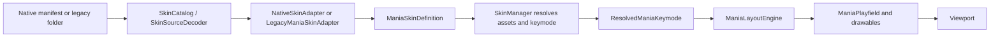

# Mania skin system

> **Work in progress:** this system is not finished or production-ready. The status labels below describe what Nullscent currently applies; they do not claim full osu!stable parity. Legacy coverage and visual/gameplay validation remain incomplete. See the final section for known limits.

Nullscent has its own normalized presentation model. Native Nullscent skins and osu!mania legacy skins enter through different decoders, then use the same resolved assets, layout engine, and drawables.



## Responsibilities

| Component | Responsibility |
| --- | --- |
| `SkinConfigParser` | Reads `skin.ini` into a legacy-only input structure. It does not decide final geometry. |
| `SkinCatalog` | Validates a folder, builds the normalized definition, reports missing, ignored, and unsupported properties. |
| `SkinSourceDecoder` | Selects the native manifest or osu! legacy adapter. |
| `NativeSkinAdapter` | Validates and loads `NullscentSkin.json`. |
| `LegacyManiaSkinAdapter` | Converts keymode sections, assets, colors, dimensions, versions, body modes, and flips into engine units. |
| `ManiaSkinDefinition` / `ManiaKeymodeDefinition` | Normalized skin recipe independent from GPU textures and viewport dimensions. |
| `SkinAssetResolver` | Resolves filenames, animation frames, `@2x`, image decoding, CPU texture reduction, and one provider's texture cache. |
| `SkinManager` | Prepares and atomically activates a skin, resolves a keymode snapshot, applies internal fallbacks, and invalidates/disposes old assets. |
| `ResolvedManiaKeymode` | Cached per-keymode profile containing loaded note, receptor, LN, stage, lighting, and judgement animations. |
| `ManiaLayoutEngine` | Maps logical lane and receptor metrics to a resized physical viewport. It does not inspect texture dimensions. |
| `ManiaPlayfield` / drawables | Draw the supplied layout, resolved textures, and user scale values. They do not parse `skin.ini`. |
| `SettingsService` / `GameSettings` | Hold user preferences independently from skin data. |

The resolved profiles are treated as immutable after activation. Skin changes produce a new definition and resolver before the old resolver is disposed. `TryActivate()` can restore the prior provider and definition if persisting the selection fails.

## Coordinates and layout

`ManiaLayoutEngine` uses a 16:9 logical canvas that is 768 units high. It applies one uniform scale and centers that design canvas inside the physical viewport, so a different aspect ratio adds letterbox space instead of distorting lanes and sprites.

The legacy adapter translates osu!mania coordinates, whose horizontal positioning is documented relative to a 480-pixel-high stage, by `LegacyManiaSkinAdapter.StableScale` (`1.6f`). The conversion is:

```text
skin.ini legacy coordinate (480-high reference)
    -> normalized 768-high mania design coordinate
    -> uniform viewport scale and letterbox offset
    -> physical window coordinate
```

`ColumnStart`, `ColumnWidth`, spacing, hit/light/score/combo positions, and line widths are converted at the adapter boundary. Lane geometry comes only from normalized configuration; texture width never sets lane width.

`ColumnRight` is **adapted**, not claimed to reproduce Stable exactly. The current layout engine treats it as an inward inset from the design canvas's right edge and constrains the playfield's right edge without changing lane widths. The wiki only describes it as the point up to which columns may be drawn, and the local osu!Lazer checkout has no equivalent mania renderer consumer. This responsive interpretation is explicit and covered by the shared layout path.

Native `placement` accepts `center`, `left`, `right`, or `legacy`. Legacy skins use their configured start and right constraint; native skins can choose an anchor. `ManiaLayoutResult` separately carries lane rectangles, playfield bounds, viewport transform, note-height scale, receptor-height scale, and hit position.

`WidthForNoteHeightScale` becomes `NoteHeightReferenceWidth`. If absent, the adapter uses the narrowest lane. Note, LN head/body/tail, and receptor each have independent width ratios and height policies. User `SkinNoteHeightScale` and `SkinReceptorHeightScale` affect sprite height without changing lane geometry.

The engine-level `PlayfieldScale` and `LaneScale` inputs exist for future user/native overrides; the current settings UI does not expose them.

## Native skin format

Each built-in skin is data under `Nullscent/Skins/<id>/`:

```text
NullscentSkin.json
bar-note.png
bar-key.png
bar-key-pressed.png
bar-hold-head.png
bar-hold-body.png
bar-hold-tail.png
```

`formatVersion` is currently `1`. The manifest contains `id`, `name`, `author`, and a `keymodes` object keyed by key count. Every keymode declares its `keyCount`, `placement`, optional hit position, column line settings, shared sprite styles, stage/lighting names, and a `lanes` array with one record per column.

Sprite styles can set `asset`, `pressedAsset`, `laneWidthRatio`, `heightMode`, `heightValue`, offsets, and `framesPerSecond`. `heightMode` is `TextureAspect`, `ReferenceWidthAspect`, or `LaneWidthFraction`. Lane definitions independently support width, following gap, note/receptor/body width ratios, per-piece asset overrides, body mode, and lane/light/hold colors. JSON enums are case-insensitive.

To add a keymode, add its profile and exactly one lane definition per column. To add an animation, name the first image `name-0.png`, then consecutive frames `name-1.png`, etc.; if no numbered frame exists, the resolver treats `name.png` as a static one-frame asset. `_blank` means intentional transparency.

## Built-in families

### Bars

`Nullscent/Skins/Bars` is the initial internal skin and the final safe visual provider. It uses full-lane rectangular notes, a stretched LN body, rectangular receptors, per-key colors, and 4K/7K profiles. Its art and proportions are manifest/assets, not a renderer branch.

### Circles

`Nullscent/Skins/Circles` uses narrower centered note sprites and independent circular receptors inside wider lanes. Its LN body tiles and its 7K manifest includes a wider center separation. It uses the same model, resolver, layout engine, and drawables as Bars.

Both manifests ship with the application and are selectable through the same catalog as external skins.

## Legacy adapter

The adapter uses the `skin.ini` version contract:

* A skin with no `skin.ini` uses latest legacy conventions and conventional asset names.
* A present `skin.ini` with no `Version` uses legacy version 1.0.
* Version 2.4 enables the documented two-sided column edge behavior and uses the post-2.4 HUD scale.
* Version 2.5 enables `NoteBodyStyle`, per-column lighting widths, and detailed note/key flip overrides.

Each `[Mania]` section is keyed by `Keys`. Extra list entries are ignored and missing entries use format defaults. The adapter emits profiles for the keycounts supported by conventional names even if the folder has no explicit `Keys` section.

### Legacy property status

`SUPPORTED` means the property reaches an active renderer/layout consumer. `ADAPTED` means it is applied using a documented Nullscent policy where exact Stable semantics are not established. `IGNORED BY DESIGN` means it is parsed for useful diagnostics but the corresponding feature is not part of this renderer. `UNSUPPORTED` means no usable normalized behavior exists.

| Properties | Status | Current behavior |
| --- | --- | --- |
| `Keys`, `ColumnWidth`, `ColumnSpacing`, `ColumnLine`, `ColumnLineWidth` | SUPPORTED | Per-keymode lanes and line geometry; missing values use defaults. |
| `ColumnStart` | ADAPTED | Converts the documented 480-high coordinate to logical units and anchors the left edge. |
| `ColumnRight` | ADAPTED | Right-edge constraint in the responsive design canvas; exact Stable parity is uncertain. |
| `HitPosition`, `LightPosition`, `ScorePosition`, `ComboPosition` | SUPPORTED | Converted once; hit position feeds layout, score/combo feed legacy judgement presentation. |
| `WidthForNoteHeightScale` | SUPPORTED | Sets note/head/tail height reference; absent uses the narrowest lane. |
| `JudgementLine`, `KeysUnderNotes`, `ColumnLighting` | SUPPORTED | Reach judgement line visibility, receptor/note ordering, and column light state. |
| `NoteImage#`, `NoteImage#H/#L/#T`, `KeyImage#`, `KeyImage#D` | SUPPORTED | Resolve per-column assets; absent LN tail may reuse the head. Missing active-skin assets fall back to built-in assets. |
| `NoteBodyStyle`, `NoteBodyStyle#` | ADAPTED | `0` stretch, `1` tile from tail, `2` tile from head; recognized textual aliases normalize to the same enum. Applied for version 2.5+. |
| `NoteFlipWhenUpsideDown[#][H/L/T]`, `KeyFlipWhenUpsideDown[#][D]` | SUPPORTED | Global, column, note-piece, and pressed-key rules normalize to profile maps; only active for version 2.5+. |
| `UpsideDown` | ADAPTED | A skin orientation preference; it controls scroll only while the user has enabled “Use Skin Scroll Direction”. Explicit user choice wins. |
| `Colour#`, `ColourLight#`, `ColourHold#`, `ColourHold`, `ColourBreak`, `ColourJudgementLine`, `ColourColumnLine` | SUPPORTED | Alpha is preserved; hold/light/lane colors feed their intended consumers. |
| `StageLeft`, `StageRight`, `StageBottom`, `StageHint`, `StageLight`, `LightingN`, `LightingL`, `LightFramePerSecond`, `LightingNWidth`, `LightingLWidth` | SUPPORTED | Stage and lighting assets resolve through the same provider-aware animation system. `LightFramePerSecond` is used by `StageLight`. |
| `SpecialStyle` | IGNORED BY DESIGN | Parser retains it for reporting; Nullscent does not implement split-stage/special-column layout. |
| `BarlineHeight`, `ColourBarline` | IGNORED BY DESIGN | Parser retains them for reporting; no barline renderer exists yet. |
| `SplitStages`, `StageSeparation`, `SeparateScore`, `WarningArrow`, `ColourKeyWarning` | UNSUPPORTED | Not converted to a renderer feature. The catalog reports unsupported legacy entries it detects. |

`NoteBodyStyle` string aliases currently accepted are `stretch`; `repeatbottom`, `repeat-bottom`, `bottom`, `tilefromtail`, `tile-from-tail`; and `repeattop`, `repeat-top`, `top`, `tilefromhead`, `tile-from-head`.

The two tile directions are anchored to opposite ends of the visible body and crop partial end tiles. Stretch maps the whole source image over the body. This implementation supports the documented direction distinction while retaining Nullscent's own clipping and logical-size rules; it does not claim exact reproduction of every Stable-version edge case. Lazer's legacy body implementation was used as a structural reference, not copied, and known lazer regressions were not treated as the Stable contract.

## Assets, `@2x`, and fallbacks

`SkinAssetResolver` checks only the selected provider's directory, including its optional `@2x` variant. The active user skin never borrows arbitrary files from another external skin. Resolution order is:

```text
selected skin provider
    -> built-in Bars provider
    -> emergency geometric/text fallback if a required visual is still absent
```

For a keymode missing from a selected definition, the whole internal keymode profile is used rather than mixing geometry from unrelated keymodes. For a present partial keymode, missing individual images use the matching internal image.

`@2x` changes physical source pixels, not logical display size: `LogicalSize` is source width/height divided by two, while `SourcePixelSize` and `TexturePixelSize` retain physical sizes. When the GPU limit is exceeded, the decoder downsamples on CPU with one uniform ratio before upload. Current limits are 8192 per axis for `HiDef` and 2048 for MonoGame `Reach`; logical dimensions and aspect ratio stay based on the original decoded asset.

The `SkinAssetResolver` is owned by a single provider and caches decoded textures. Skin activation clears animation/keymode metadata caches, increments a version, notifies layout consumers, then disposes the previous selected-skin resolver. The internal provider persists for the manager's lifetime.

## Animation rules

The resolver discovers numbered frames once and stores them in `ResolvedSkinAnimation`; draw calls do not enumerate the filesystem. `FrameAt()` loops, while hit judgement frames use a clamped timeline.

* `AnimationFramerate` is normalized from `[General]`. A positive value is preserved; `-1` resolves to the frame count, meaning the complete animation spans one second.
* Mania note, LN head/body/tail, and note/hold lighting use explicit Mania rates and do not inherit the general rate.
* `LightFramePerSecond` controls the `StageLight` animation only.
* Receptors, non-light stage parts, and judgement assets use the general rate.

The local lazer source uses an effect-lifetime based frame length for hit lighting and a fixed 30 FPS for legacy body animations. Nullscent currently uses its own cached fixed-rate animation model for note/hold lighting; the timing of very short multi-frame lighting effects remains an approximation for manual review.

## Layering and HUD

The current playfield order is:

1. Stage background and lane backgrounds.
2. Stage/column light behind notes.
3. Notes and receptors in the order selected by `KeysUnderNotes`.
4. `StageBottom` over the lane pass.
5. Flashlight mask.
6. Legacy judgement/combo display.
7. Foreground hit explosions and active LN lighting.

`StageLeft` and `StageRight` are side pieces sized from their logical texture aspect; `StageBottom` and `StageHint` have distinct draw paths. The stage does not define note lane geometry. Nullscent score/accuracy/progress UI remains engine UI; legacy score/combo positions and skin digit assets feed the legacy presentation path where present.

## User preferences and precedence

* Receptor position: when `UseSkinReceptorPosition` is on, use the skin hit position; otherwise use the user's normalized `ReceptorPosition`.
* Scroll direction: when `UseSkinScrollDirection` is on and the skin defines `UpsideDown`, `0` means downscroll and `1` means upscroll. Otherwise retain the saved user `DownScroll`. Toggling `Down Scroll` sets an explicit user direction and disables following the skin.
* Note height and receptor height are independent settings. They are passed through the layout result to drawables; neither changes lane width.
* Skin files are not mutated to apply user preferences.

## Validation states and diagnostics

`SkinCatalog` reports `Valid`, `Partial`, or `Invalid`. A partial skin remains usable when missing art can safely fall back. Invalid native manifests or parse errors do not replace the currently active skin. Missing images and ignored/unsupported properties are reported during validation/resolve, not every frame.

A folder without `skin.ini` but with recognized conventional Mania assets has a defined latest-rules path and remains usable; the catalog labels it partial because it has no explicit keymode configuration and may need defaults/fallbacks.

The current catalog marks properties by actual adapter/consumer status, not by parser recognition alone. `ColourHold#` is applied per lane and is classified as supported. `SpecialStyle`, `BarlineHeight`, and `ColourBarline` are deliberately reported as ignored until their renderers exist.

## Regression fixture and screenshots

`Skin/Aristia Refreshed` is a local-only third-party regression fixture copied from the user's osu! installation. It exercises multiple Mania sections, asymmetric per-column values, legacy stage pieces, `@2x`, and missing LN-tail fallback. `Skin/` is ignored by Git; do not distribute this fixture. It is not a named-skin branch or product dependency.

The DEBUG-only harness is `SkinVisualSmokeGame`, invoked by `--skin-visual-smoke`, `--skin-visual-switch-smoke`, and `--skin-visual-resize-smoke`. It accepts arbitrary skin paths, keycounts, resolutions, up/downscroll, controlled chords and LN patterns. It is excluded from Release by `#if DEBUG`. Representative final outputs are written under `bin/Debug/net8.0-windows/Screenshots/skinning-v2-final/`.

## Adding a fourth skin

1. Create `Nullscent/Skins/<id>/NullscentSkin.json` with a new `id`, metadata, and one profile per desired keycount.
2. Define each lane width and gap independently. Choose note, receptor, LN, and stage assets through style fields or lane overrides.
3. Choose `TextureAspect`, `ReferenceWidthAspect`, or `LaneWidthFraction` for each sprite role; set independent width ratios and offsets.
4. Choose `Stretch`, `TileFromTail`, or `TileFromHead` for LN body rendering.
5. Add regular and optional `@2x` images. Use consecutive `name-0`, `name-1` animation frames when animated.
6. Validate the folder in the catalog, then run DEBUG smoke for 4K and 7K at 1920x1080 and 1366x768, including long notes and one resize.
7. Review both missing-asset warnings and the generated screenshots. The renderer should not need a skin-name branch.

## References and limits

* Official [osu! skin.ini wiki](https://osu.ppy.sh/wiki/en/Skinning/skin.ini): version defaults, 480-pixel Mania coordinate reference, missing/extra list rules, `NoteBodyStyle`, and animation exceptions.
* Official [blank skin.ini template](https://osu.ppy.sh/wiki/en/Skinning/skin.ini/Blank): property sections and accepted legacy field names.
* osu!Lazer source, local read-only checkout: `osu.Game.Rulesets.Mania/Skinning/Legacy/LegacyBodyPiece.cs`, `LegacyColumnBackground.cs`, `LegacyHitExplosion.cs`, `LegacyNotePiece.cs`, `ManiaLegacySkinTransformer.cs`, and `osu.Game/Skinning/LegacyManiaSkinDecoder.cs`. Used to follow asset selection, StageLight FPS, layer ownership, and LN animation structure. No source files were copied into Nullscent.
* osu!Lazer PR [#22389](https://github.com/ppy/osu/pull/22389): reference for decoding oversized images on CPU before GPU upload. Nullscent uses its own MonoGame resolver/downscale implementation.
* McOsu local checkout was used as a visual reference only. A separate `osu-stable-reference` checkout was not present in the supplied `source/repos/osu` folder, so claims of exact Stable parity are intentionally avoided.

Beatmap skin precedence, split stages, barlines, other rulesets, and obscure Stable-only historical quirks remain outside the supported subset.
